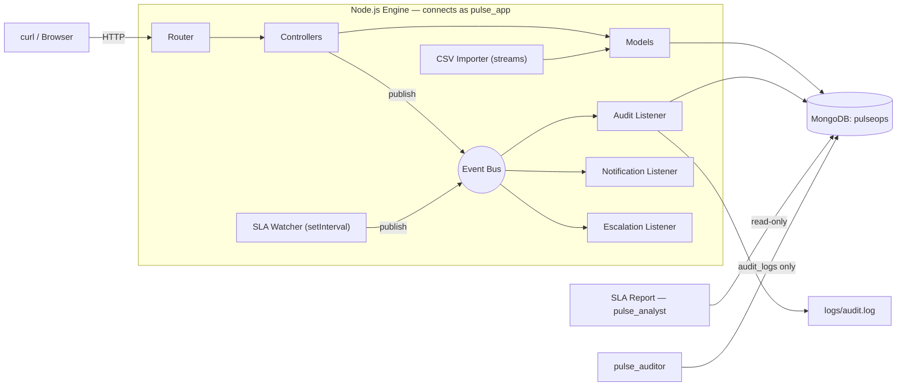
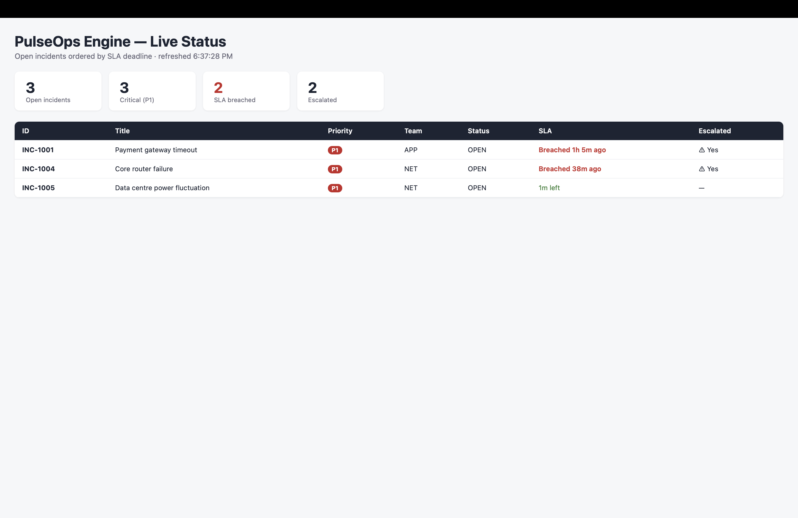
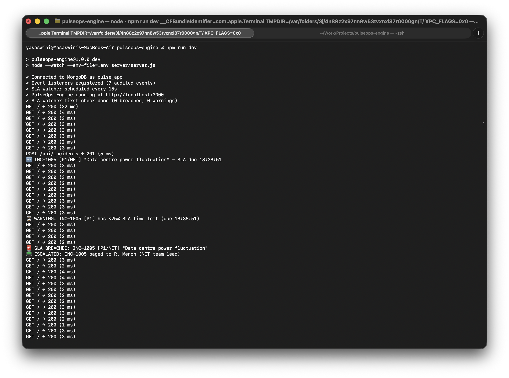
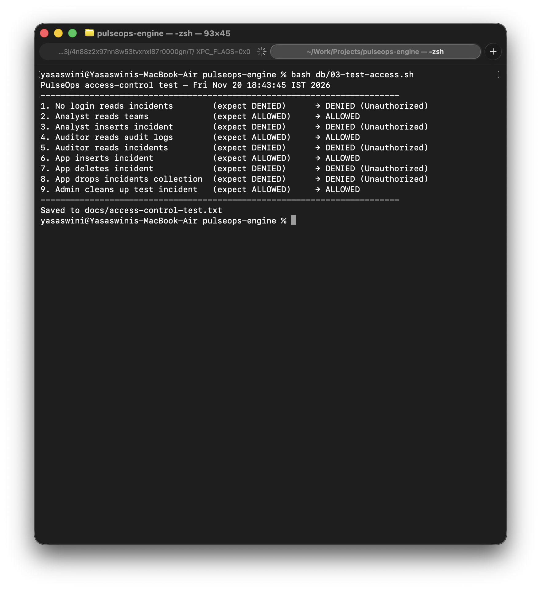
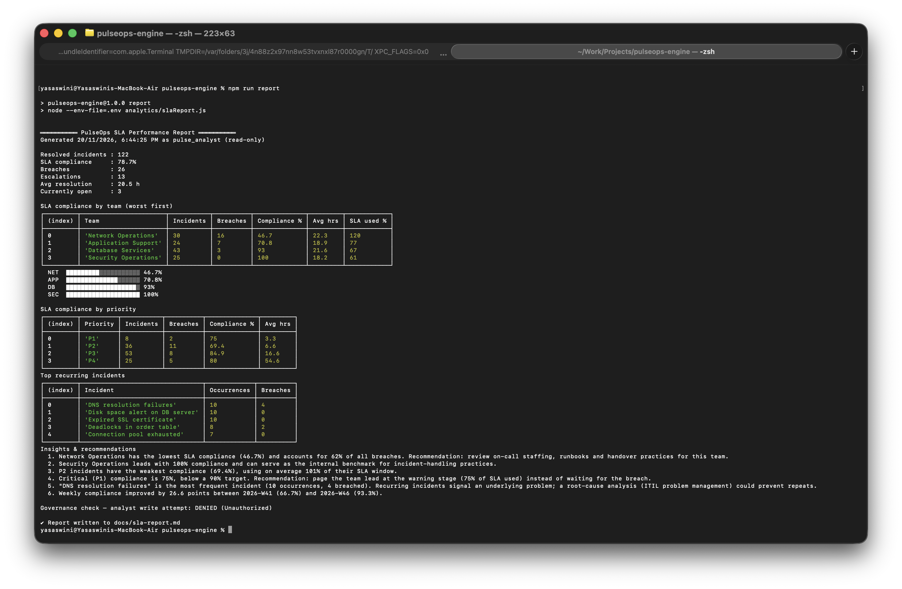
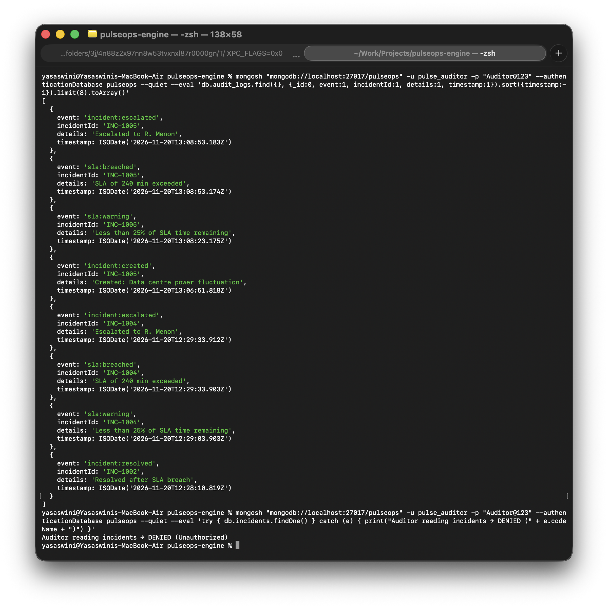

# PulseOps Engine

**An event-driven IT incident and SLA monitoring engine built with Node.js and MongoDB.**

PulseOps Engine tracks IT incidents from creation to resolution. It monitors every incident against its Service Level Agreement (SLA) in real time, escalates breaches to the responsible team lead automatically, keeps a tamper-resistant audit trail, and turns historical ticket data into management insights.

> **Part 1 of the PulseOps suite.** This repository is the *engine*: backend services, data governance and analytics. Part 2, **PulseOps Console**, will provide the management web interface (React, Angular and Express) on the same data.

---

## The business problem

When systems fail (payments, VPN, logins), IT teams commit to fixing them within agreed SLA times. Missed SLAs mean lost revenue, unhappy customers and contractual penalties. Managers need three things:

1. **Real-time awareness:** which incidents are about to breach, right now?
2. **Accountability:** who was notified, when, and what changed?
3. **Insight:** which teams and issue types fail most, and what should change?

PulseOps addresses each one with an automated SLA watcher, an event-sourced audit trail and an analytics report with recommendations.

---

## Features

| Area | What it does |
|---|---|
| **Incident API** | REST API on Node's core `http` module (no framework) to create, list, filter and update incidents |
| **SLA engine** | Every incident gets an SLA deadline from its priority (P1 = 4 h … P4 = 72 h) |
| **Lifecycle rules** | Enforced state machine: `OPEN → IN_PROGRESS → RESOLVED`; resolved incidents cannot be reopened |
| **SLA watcher** | Timer-driven background job that raises **warnings** at 75% of SLA used and detects **breaches** |
| **Escalation policy** | Breached P1/P2 incidents are automatically escalated to the owning team's lead |
| **Audit trail** | Every event is written to MongoDB and to an append-only log file |
| **Bulk import** | Streams a historical ticket export (CSV) line by line, with validation and duplicate handling |
| **SLA analytics** | Aggregation-pipeline report on compliance by team, priority and week, recurring issues and rule-based recommendations |
| **Live status board** | Server-rendered HTML view of open incidents ordered by SLA urgency |
| **Least-privilege security** | Four database roles; each component connects with only the access it needs |

---

## Architecture



The engine follows the **MVC pattern**:

- **Model** (`server/models`): data access, SLA calculation and lifecycle rules
- **View** (`server/views`): the HTML status board
- **Controller** (`server/controllers`): request handling and event publishing
- **Router** (`server/routes`): maps HTTP methods and URLs to controllers

The **event bus** decouples actions from their side effects. Controllers publish events without knowing who listens, so new behaviour (for example, email alerts) can be added without touching existing code.

---

## Security model (least privilege)

| Database user | Role | Can | Cannot |
|---|---|---|---|
| `pulse_admin` | Platform admin | Manage users and databases | — |
| `pulse_app` | `incidentOperator` (custom) | Create/update incidents, **write** audit logs | Delete incidents, drop collections, **read** audit logs |
| `pulse_analyst` | `read` | Read all operational data | Modify anything |
| `pulse_auditor` | `auditReader` (custom) | Read audit logs only | See incident data |

**Separation of duties:** the application writes the audit trail but cannot read or alter it. Only the auditor can review it. The access rules are verified by an automated test (`npm run test:access`). The results are in [`docs/access-control-test.txt`](docs/access-control-test.txt).

The `incidents` collection also uses **JSON Schema validation**, so invalid priorities, teams or statuses are rejected by the database itself.

---

## Sample analytics results

From 120 historical incidents (full report: [`docs/sla-report.md`](docs/sla-report.md)):

| Team | Compliance |
|---|---|
| Network Operations | 46.7% |
| Application Support | 70.8% |
| Database Services | 93.0% |
| Security Operations | 100% |

**Key findings generated by the report:**
- Network Operations accounts for **62% of all SLA breaches**, so staffing and runbooks should be reviewed.
- Critical (P1) compliance is **75%**, below a 90% target, so the recommendation is to page leads at the warning stage.
- "DNS resolution failures" recurs most often (10 times), which makes it a candidate for root-cause analysis.

---

## Tech stack

- **Runtime:** Node.js 24 (core `http`, `events`, `fs`, `readline`, timers)
- **Database:** MongoDB 8 (role-based access control, schema validation, aggregation pipelines)
- **Driver:** official `mongodb` Node.js driver
- **No web framework:** routing, body parsing and error handling are implemented from first principles

---

## Project structure

```
pulseops-engine/
├── analytics/slaReport.js          # SLA analytics report (read-only analyst)
├── data/historical_incidents.csv   # 120-incident historical export
├── db/
│   ├── 01-create-users.js          # Users and custom roles
│   ├── 02-setup-collections.js     # Collections, validation, indexes, reference data
│   └── 03-test-access.sh           # Access-control verification
├── docs/                           # Reports, test evidence, screenshots
├── logs/                           # audit.log (generated at runtime)
├── scripts/generate-sample-data.js # Reproducible sample data generator
└── server/
    ├── config/db.js                # MongoDB connection
    ├── controllers/                # Incident, system and import controllers
    ├── events/                     # Event bus and listeners
    ├── models/incidentModel.js     # Data access and business rules
    ├── routes/router.js            # URL routing
    ├── services/                   # SLA watcher, CSV importer
    ├── utils/http.js               # JSON responses, body parsing, errors
    ├── views/statusPage.js         # HTML status board
    └── server.js                   # Entry point
```

---

## Getting started (macOS)

```bash
# 1. Install MongoDB
brew tap mongodb/brew && brew trust mongodb/brew
brew install mongodb-community
brew services start mongodb-community

# 2. Install dependencies
npm install

# 3. Create users, roles and collections (before enabling auth)
mongosh db/01-create-users.js
mongosh db/02-setup-collections.js

# 4. Enable access control
printf "\nsecurity:\n  authorization: enabled\n" >> /opt/homebrew/etc/mongod.conf
brew services restart mongodb-community
npm run test:access

# 5. Configure and run
cp .env.example .env        # then fill in the passwords
npm run generate-data
npm run dev
```

| Command | Purpose |
|---|---|
| `npm run dev` | Start the engine with auto-reload |
| `npm run generate-data` | Create the historical CSV |
| `npm run report` | Generate the SLA analytics report |
| `npm run test:access` | Verify database access control |

`SLA_TIME_SCALE=120` in `.env` speeds up SLA time for demos (a 4-hour P1 SLA becomes 2 minutes).

---

## API reference

| Method | Endpoint | Description |
|---|---|---|
| `GET` | `/` | Live HTML status board |
| `GET` | `/api/health` | Service and database health |
| `GET` | `/api/incidents?status=&priority=&team=` | List and filter incidents |
| `POST` | `/api/incidents` | Create an incident (`title`, `priority`, `team`, `description`) |
| `GET` | `/api/incidents/:id` | Get one incident with its history |
| `PATCH` | `/api/incidents/:id/status` | Change status (lifecycle rules enforced) |
| `POST` | `/api/import` | Import `data/historical_incidents.csv` |

**Example**
```bash
curl -X POST localhost:3000/api/incidents -H "Content-Type: application/json" \
  -d '{"title":"Payment gateway timeout","priority":"P1","team":"APP"}'
```

---

## Screenshots

| Live status board | Event-driven SLA monitoring |
|---|---|
|  |  |

| Access-control verification | SLA analytics report |
|---|---|
|  |  |



---

## Part 2: PulseOps Console

The management interface for this engine is available at **[pulseops-console](https://github.com/yasaswini-p/pulseops-console)**: an Express REST API, a React manager dashboard and an Angular operator console that work on the same database.

---

**Author:** Yasaswini Puchakayala, B.E. Computer Science & Engineering, New Horizon College of Engineering, Bengaluru